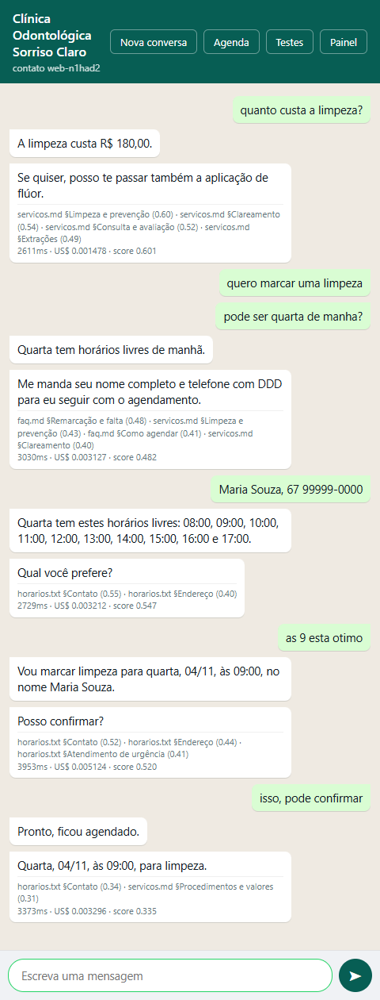
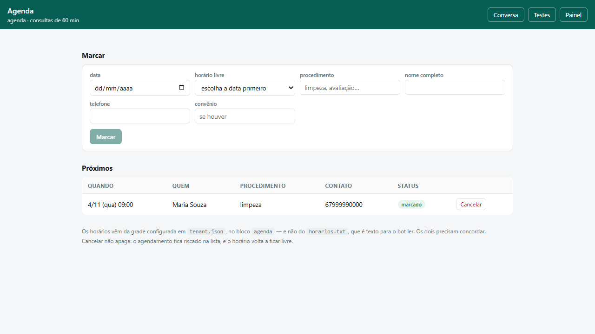
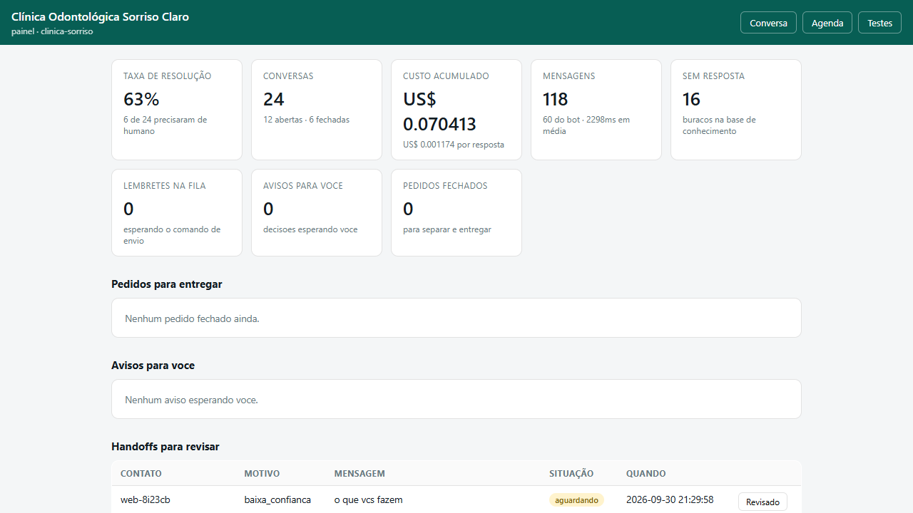
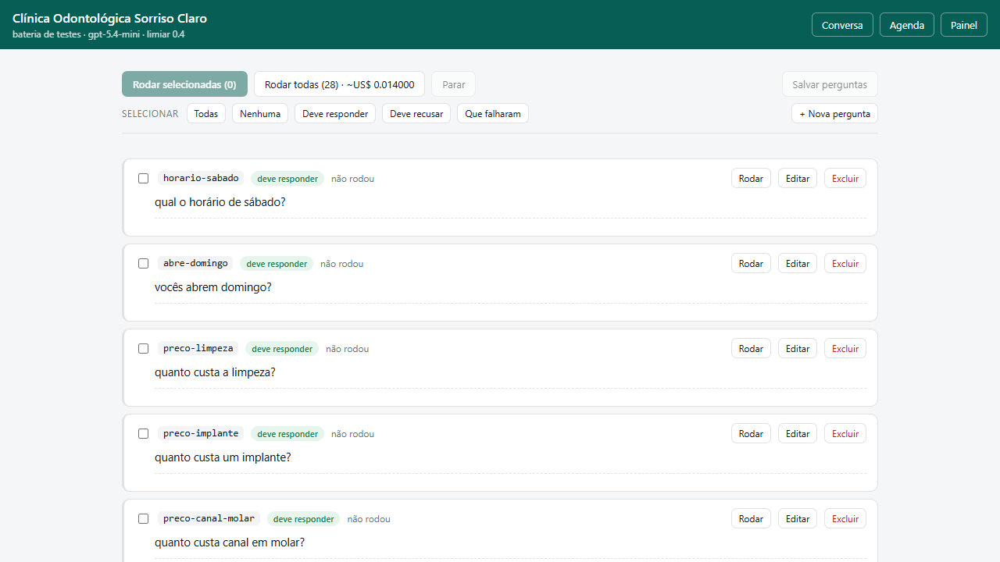

# Motor de atendimento por IA

Núcleo de um bot de atendimento para WhatsApp que responde a partir dos
documentos de cada cliente, marca consultas e monta pedidos, com o canal
isolado numa borda substituível.


<table>
  <tr>
    <td valign="top">
      
    </td>
    <td valign="top">
      
      <br />
      
      <br />
      
    </td>
  </tr>
</table>

## O que é

Pequeno negócio perde cliente porque ninguém responde o WhatsApp a tempo, e
responde errado quando responde com pressa. Este é o motor que atende por ele:
busca a resposta nos documentos do próprio negócio, marca e remarca consultas,
monta pedido e informa o total, e passa para uma pessoa quando não sabe.

Nesta fase ele roda **100% local**, sem WhatsApp e sem nuvem, de propósito: a
parte difícil é calibrar qualidade, e calibrar é barato quando dá para rodar a
conversa inteira na própria máquina e ler o número depois. A Cloud API entra
quando a qualidade estiver medida, e entra como mais um adaptador.

## Decisões técnicas

**O canal é um adaptador de borda, e isso já foi exercitado.** `src/core/` não
sabe se fala com terminal, página ou WhatsApp. O núcleo devolve `mensagens[]` e
`acoes: [{id, rotulo}]`, e quem decide a forma é a borda: balão na página, botão
de resposta no WhatsApp, linha no terminal. O botão "falar com o atendente
virtual" nasceu assim, sem o núcleo saber o que é um botão.

**O limiar de confiança não barra mensagem nenhuma.** `npm run calibrar` mostrou
que os dois grupos se sobrepõem: perguntas que a base responde tiram de 0.426 a
0.733, e perguntas sem resposta chegam a 0.593. Nenhum número separa os dois.
Ele já foi porteiro e `"boa tarde"` tirou 0.370, acionando um atendente para
responder a um cumprimento. Hoje ele só escolhe se o contexto vai como firme ou
marcado como fraco; quem decide escalar é o modelo.

**O que não pode falhar está na assinatura da ferramenta, não no prompt.**
Prompt é desobedecido. Então confirmar antes de cancelar é `confirmado: boolean`
em `cancelar_agendamento`, telefone é conferido por contagem de dígitos (campo
obrigatório de texto aceita "não informado"), e dupla marcação é um índice único
parcial no SQLite, não uma checagem em código que perde a corrida entre o SELECT
e o INSERT.

**O carrinho vive em tabela e a conta é somada em código.** Nasceu de um caso
real: o bot listou três itens e informou R$ 60,00 num pedido de R$ 110,00. A
aritmética dele estava certa em toda conta isolada, o que ele não consegue é
manter uma lista ao longo da conversa. Preço em centavos e copiado para o item
no momento em que ele entra, porque pedido é registro histórico. Produto fora do
catálogo é recusa, não aproximação.

**Mensagens seguidas viram um turno só, e o agrupador mora no núcleo.** Ninguém
escreve um parágrafo no WhatsApp: escreve "quero marcar", "pra sexta", "as 9".
Esperar o cliente parar de digitar seria melhor e não é possível, porque no
WhatsApp oficial o indicador de digitação é mão única, do negócio para o
cliente. Então o contador reinicia a cada mensagem que chega, que é o único
sinal que existe. Medido com a API real: 47% mais barato, e numa comparação lado
a lado a versão sem agrupamento chegou a confirmar um horário ocupado.

**Duas réguas de qualidade que discordam.** `npm run avaliar` mede pergunta
isolada contra a API real; `npm run conversas` audita a conversa inteira lendo
só o banco, de graça, e pega o que a primeira não vê: pedir duas vezes o mesmo
dado, afirmar preço sem contexto, perder o fio. Os bugs mais graves do projeto
apareceram conversando na página, não na suíte.

**Custo reportado soma todas as chamadas.** Inclusive as voltas de ferramenta e
a compactação de memória. Custo que ignora uma chamada paga é ficção, e é o
número que decide se o produto fecha a conta.

## Stack

| Camada | Escolha |
|---|---|
| Linguagem | TypeScript 5.8 em `strict`, com `noUncheckedIndexedAccess` |
| Execução | `tsx` para rodar, `tsc --noEmit` para checar, sem build |
| Banco | SQLite via `better-sqlite3` 13, migrations em SQL puro |
| HTTP | `node:http` direto, sem framework |
| Busca vetorial | cosseno em memória, atrás da interface `BuscaVetorial` |
| Embeddings | OpenAI `text-embedding-3-small`, 1536 dimensões |
| LLM | OpenAI, com tool calling. Id em `config.ts` ou no `.env` |
| Testes | Vitest 3.1, 530 testes offline |

Sem LangChain e sem banco vetorial: nesta escala o cosseno em memória resolve, e
`Embedder`, `LlmClient` e `BuscaVetorial` são interfaces, então trocar de
provedor ou migrar para `sqlite-vec` é acrescentar uma implementação.

## Como rodar

**Pré-requisitos:** Node.js 22 ou mais novo (exigido pelo `better-sqlite3` 13) e
uma chave da OpenAI. O `better-sqlite3` usa binário pré-compilado, então não
precisa de compilador C.

```bash
git clone <url-do-repositorio>
cd <pasta-do-repositorio>
npm install

cp .env.example .env          # e preencha OPENAI_API_KEY

npm run seed   -- clinica-sorriso   # cria o tenant a partir do tenant.json
npm run ingest -- clinica-sorriso   # documentos -> chunks -> embeddings -> banco
npm run web    -- clinica-sorriso   # http://localhost:3000
```

O `npm run web` sobe quatro páginas: `/` (conversa), `/agenda` (a agenda da
recepção), `/testes` (bateria de perguntas) e `/painel` (números, handoffs e
lembretes na fila).

Três clientes de exemplo já vêm prontos em `data/tenants/`, e os dois primeiros
exercitam caminhos opostos do motor de propósito: `clinica-sorriso` agenda e não
vende, `polpa-santa-helena` vende e não agenda. O terceiro é
`barbearia-do-ze`, que não faz nem uma coisa nem outra: responde só a partir dos
documentos.

### Scripts

| Comando | O que faz | Custo |
|---|---|---|
| `npm test` | 530 testes offline | zero |
| `npm run test:watch` | os mesmos, em watch | zero |
| `npm run typecheck` | `tsc --noEmit` | zero |
| `npm run novo-tenant -- <slug> "<Nome>"` | cria a pasta de um cliente novo | zero |
| `npm run seed -- <slug>` | cria ou atualiza o tenant no banco | zero |
| `npm run conversas -- <slug>` | aproveitamento por conversa | zero |
| `npm run lembretes -- <slug>` | enfileira os lembretes das consultas de hoje | zero |
| `npm run relatorio` | histórico das avaliações | zero |
| `npm run ingest -- <slug>` | indexa os documentos do cliente | embeddings |
| `npm run cli -- <slug>` | conversa no terminal | por mensagem |
| `npm run web -- <slug>` | as quatro páginas | por mensagem |
| `npm run calibrar -- <slug>` | mede os scores e sugere o limiar | embeddings |
| `npm run avaliar -- <slug>` | suíte de qualidade contra a API real | ~US$ 0,01 |

As opções de cada comando estão em [docs/operacao.md](docs/operacao.md).

### Variáveis de ambiente

| Variável | Efeito | Padrão |
|---|---|---|
| `OPENAI_API_KEY` | embeddings e chat. Obrigatória para ingerir, conversar e avaliar | nenhum |
| `LLM_MODEL` | sobrescreve o modelo de chat | `gpt-5.4-mini` |
| `WEB_PORT` | porta do adaptador web | `3000` |

Trocar o modelo pelo `.env` pede também atualizar os preços em
[`src/config.ts`](src/config.ts), senão o custo reportado deixa de valer.

## Estrutura de pastas

```
src/
  config.ts          # todo valor ajustável do projeto mora aqui
  core/              # não conhece canal nenhum
    engine.ts        # porta única de entrada: responder(tenant, contato, texto)
    rag/             # chunking, embeddings, vetores, busca
    llm/             # cliente do modelo e montagem dos prompts
    tenant/          # carga do tenant e config efetiva
    conversation/    # janela de contexto, turno social, agrupador e auditoria
    agenda/          # grade de horários, operações, ferramentas e lembretes
    pedido/          # carrinho em tabela, catálogo de preços e ferramentas de venda
    alertas/         # avisos para o dono, que NÃO calam o bot
    avaliacao/       # regras de acerto, execução da suíte, logs e estabilidade
    painel/          # números do painel
  storage/           # SQLite: conexão, migrations e repositórios
  adapters/
    cli/             # simulador no terminal
    web/             # servidor HTTP e as quatro páginas
  scripts/           # seed, ingestão, calibração, avaliação, relatório e lembretes
data/tenants/<slug>/ # documentos + tenant.json + avaliacao.json + produtos.json
docs/                # operação, cliente novo, avaliação e as capturas
logs/                # histórico das avaliações, versionado de propósito
tests/               # 20 arquivos de teste, 530 casos, mais os dublês em helpers/
```

## Documentação

| Arquivo | Para quê |
|---|---|
| [docs/operacao.md](docs/operacao.md) | todos os comandos e opções, `.env`, logs e fuso |
| [docs/novo-cliente.md](docs/novo-cliente.md) | colocar um negócio real no motor: `tenant.json`, agenda, `produtos.json` |
| [docs/avaliacao.md](docs/avaliacao.md) | as três réguas de qualidade e como calibrar o limiar |
| [PROGRESSO.md](PROGRESSO.md) | a história do projeto, etapa por etapa, com o porquê de cada decisão |

## Estado

Última medição paga, em 2026-10-02: **100% de acurácia e 100% de estabilidade**
em 5 rodadas consecutivas da suíte da clínica, 28 de 28 em todas, zero
oscilação, por US$ 0,0739. A suíte offline tem 530 testes e o `typecheck` está
limpo.

Fora de escopo nesta fase: WhatsApp e Cloud API, qualquer nuvem, autenticação,
painel administrativo completo, e o bot processar pagamento. Anotar a forma de
pagamento escolhida é diferente, e isso ele faz.
